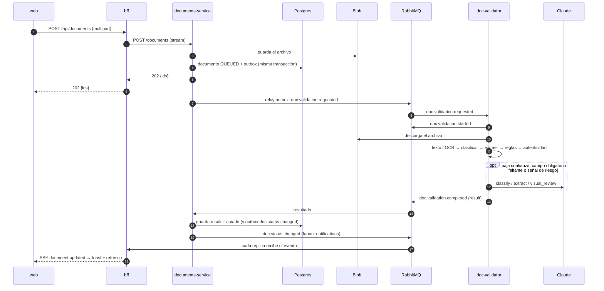

# Arquitectura

## Problema

Validar documentos que llegan como PDF con texto, PDF escaneado o imagen: identificar el tipo según un **template**, extraer sus datos a **JSON**, verificar **vigencia**, **totales** (facturas y órdenes de compra) y **riesgo de falsificación**. El usuario sube varios documentos, sigue trabajando y recibe una notificación cuando cada uno termina.

## Vista general

| Pieza | Tecnología | Estado | Responsabilidad |
|---|---|---|---|
| `apps/web` | React 19, Vite, TanStack Query, Tailwind 4 | sin estado | Playground: subir, ver estado en vivo y resultado |
| `services/bff` | NestJS 11 (Node 24) | sin estado | API de la UI, subida en streaming, SSE |
| `services/documents-service` | NestJS 11, Prisma 6, amqplib | Postgres + Blob | Dueño del documento, outbox, resultados |
| `services/doc-validator` | Python 3.12, aio-pika, PyMuPDF, OpenCV, Tesseract, SDK `anthropic` | sin estado | Pipeline de validación |
| RabbitMQ 4.1 | colas quorum | | Mensajería asíncrona |
| PostgreSQL 17 | JSONB | | Documentos, resultados y outbox |
| Azure Blob (Azurite en local) | | | Archivos originales |

Ver también [piezas-lego.md](piezas-lego.md) (contratos y combinaciones) y los [ADRs](adr/).

## Flujo de un documento



Estados: `QUEUED → PROCESSING → COMPLETED | FAILED`. Un estado nunca retrocede (los eventos atrasados o duplicados se ignoran).

## Pipeline del validador

```
ingest → pdf_inspector → ocr → classifier → extractor → rules → authenticity → signature → result
```

1. **ingest:** tipo real por magic bytes (PDF, PNG, JPEG, TIFF) y tamaño máximo.
2. **pdf_inspector:** lee solo el texto **visible** (descarta lo tapado por rectángulos blancos). Reconstruye líneas por coordenadas y separa palabras que el PDF escribió sin espacios (caso Oracle Publisher). Decide si la página necesita OCR: poco texto, o página casi toda imagen aunque traiga algo de texto encima. Reúne hechos forenses: metadatos, actualizaciones incrementales, copias concatenadas, fuentes en zonas de montos y cifras escritas sobre un escaneo.
3. **ocr:** OpenCV (enderezado, filtro de mediana, binarización adaptativa) + Tesseract `spa+eng`.
4. **classifier:** cada template suma el peso de sus palabras clave encontradas. Con confianza < 0,6 y IA disponible, decide Claude; con < 0,3 sin IA, el tipo queda `desconocido`.
5. **extractor:** patrones del template, en orden de preferencia. Si un campo **obligatorio** falta o tiene confianza < 0,5, se le pide a Claude con el schema pydantic del tipo. Cada campo indica su origen (`text`, `ocr` o `llm`) y su confianza.
6. **rules:** RUT con módulo 11, fechas, vigencia y totales (Σ líneas = neto, neto × 19 % = IVA ±1 peso, neto + IVA + exento = total).
7. **authenticity:** señales heurísticas combinadas (score = 1 − Π(1 − peso)): MEDIUM desde 0,3 y HIGH desde 0,6. Claude solo opina si ya hay una señal con peso, y su aporte máximo es 0,25.
8. **signature:** punto de extensión, hoy `NOT_IMPLEMENTED`.
9. **result:** arma el [`ValidationResult`](../contracts/validation-result.schema.json) con el veredicto y `llmCalls`.

**Veredicto:**
- `INVALID`: falla un check de severidad error.
- `REVIEW`: riesgo MEDIUM o HIGH, tipo desconocido u OCR de baja confianza.
- `VALID`: en cualquier otro caso.

### Señales de autenticidad

| Señal | Peso | Qué detecta |
|---|---|---|
| `pdf.mod_date_differs` | 0,25 | ModDate distinto de CreationDate |
| `pdf.editor_producer` | 0,35 | Productor o creador es un editor de PDF o de imágenes |
| `pdf.incremental_updates` | 0,35–0,45 | Actualizaciones incrementales reales |
| `pdf.repeated_copies` | 0 | El archivo es el mismo PDF concatenado varias veces (informativa) |
| `pdf.amount_font_mix` | 0,3 | Cifras de montos con más de una familia de fuente |
| `pdf.hidden_text` | 0,35 | Texto invisible con cifras en una página con texto visible |
| `pdf.covered_text` | 0,4 | Texto tapado con rectángulos blancos |
| `pdf.text_vs_render` | 0,3 | Cifras del texto embebido que no se ven en la página |
| `pdf.text_over_scan` | 0,3 | Cifras escritas como texto encima de un escaneo |
| `image.editor_software` | 0,35 | EXIF de la imagen indica un editor |
| `image.ela` | 0,2 | Error Level Analysis detecta un parche burdo |
| `llm.visual_review` | ≤ 0,25 | Opinión visual de Claude (nunca decisiva sola) |

Es una **estimación de riesgo, no una prueba**. No detecta un PDF regenerado desde cero con datos falsos (ahí solo ayudan las reglas de totales) ni una imagen retocada con cuidado.

## Tipos de documento

| Tipo | Validaciones | Probado con documentos reales |
|---|---|---|
| `factura_sii` | RUTs, totales, suma de líneas | Solo con documentos generados |
| `orden_compra` | RUTs, totales, suma de líneas | Sí (formato Oracle Publisher) |
| `certificado_vigencia` | Vigencia (vencimiento o días de validez, 30 por defecto) | Solo con documentos generados |
| `cedula_identidad` | RUN, vencimiento | Solo con textos de ejemplo |
| `contrato` | RUTs de las partes y vigencia si tiene fecha de término | Solo con textos de ejemplo |
| `certificado_accidentabilidad` | Identificación y extracción (sin vigencia) | Sí (Mutual de Seguridad, IST, ACHS, ISL) |
| `carpeta_tributaria` | Identificación y extracción | Sí (SII) |
| `certificado_f30` | Identificación y extracción | **No**: patrones escritos sin un ejemplo real |

## Datos

**Postgres (documents-service):**
- **Tabla `documents`:** metadatos del archivo, `status`, `result` (JSONB con índice GIN), `error`, `attempts`, más `document_type` y `verdict` desnormalizados para listar.
- **Tabla `outbox`:** eventos pendientes de publicar, con reintentos y backoff.

**Blob:** `<container>/<aaaa>/<mm>/<dd>/<uuid>/<nombre-saneado>`.

**Lo que no se guarda:** el texto completo del documento (OCR o texto extraído). Ver *Brechas* en [piezas-lego.md](piezas-lego.md).

## Mensajería

- **Exchange `documents`** (topic), colas quorum, `delivery_mode=2` y CloudEvents 1.0. Detalle en [contracts/README.md](../contracts/README.md).
- **Reintentos:** cola `retry` con TTL de 10 s; tras 3 intentos el mensaje va a la DLQ y el documento queda `FAILED`. Los errores no reintentables (archivo no soportado, blob inexistente) van directo a la DLQ.
- **Outbox:**
  - Publica con `FOR UPDATE SKIP LOCKED`, publisher confirms y `mandatory`.
  - Si el validador aún no declaró su cola, el mensaje se reintenta; no se pierde.
- **Notificaciones:** exchange fanout `notifications`, con una cola exclusiva por réplica del BFF.

## Uso de IA (Claude)

- **Modelo:** `CLAUDE_MODEL` (por defecto `claude-sonnet-5-5`) con salida estructurada (JSON Schema).
- **Prompt:** el system prompt con los templates va en caché.
- **Si falla:** cualquier error de la IA devuelve `None` y el pipeline sigue solo con reglas.
- **Trazabilidad:** cada llamada queda en `result.llmCalls` (propósito, resultado, modelo, tiempo, tokens, campos pedidos), en los logs (con `request_id`) y en la métrica `doc_validator_llm_calls_total{purpose,outcome}`.
- **Cuándo se llama:** ver la tabla del README raíz. Sin `ANTHROPIC_API_KEY` no se llama nunca.

## Despliegue (AKS)

- **Charts:** uno por servicio sobre el library chart `vd-common`, en `deploy/helm/`. Incluyen:
  - probes, recursos, HPA y PDB
  - NetworkPolicy (documents-service solo acepta tráfico del BFF)
  - topología repartida por zonas, contenedores no root con filesystem de solo lectura
  - Workload Identity, y secretos desde Key Vault con el CSI driver
- **KEDA:** escala el validador según la cola `doc-validator.requests`.
- **RabbitMQ:** Cluster Operator con 3 nodos (`deploy/k8s/rabbitmq-cluster.yaml`).
- **Ingress (app routing):**
  - `/` va a web y `/api` al BFF.
  - Para SSE: sin buffering y con timeout de lectura de 3600 s.
- **Estado de la validación:** los charts pasan `helm lint` y `helm template`, pero **no se han probado en un clúster real**.
